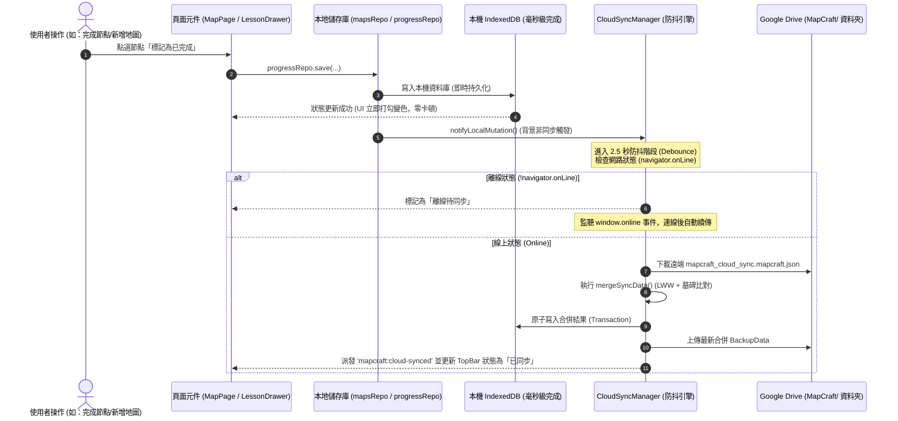
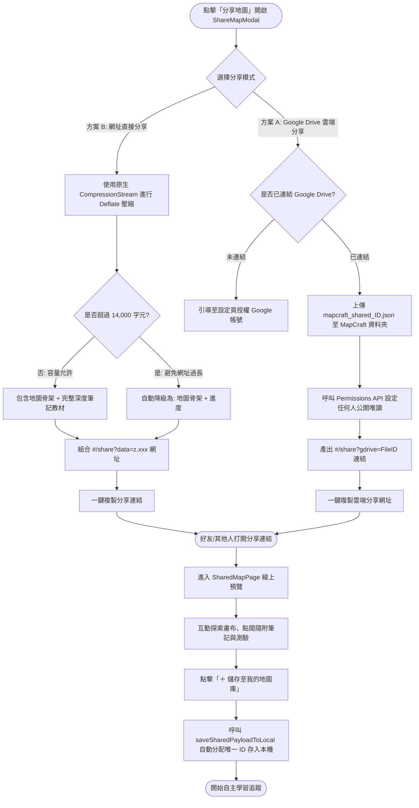
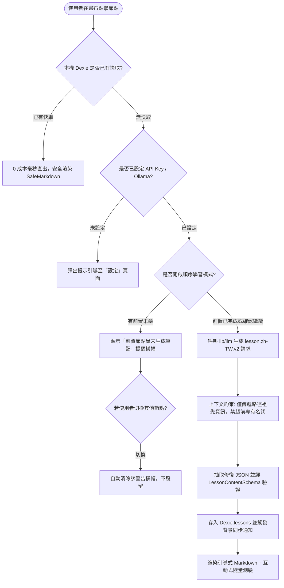

# MapCraft 架構與程式碼全景圖（CODEGRAPH）

本文檔為 MapCraft 的程式碼與架構關係圖，嚴格對應專案的工程分層原則（`App → Features → Domain → Lib → Shared`）與模組職責。

---

## 1. 系統分層架構全景（Clean Architecture & Module Boundaries）

```mermaid
graph TD
    classDef app fill:#f87171,stroke:#b91c1c,color:#fff,stroke-width:2px;
    classDef features fill:#fbbf24,stroke:#d97706,color:#000,stroke-width:2px;
    classDef domain fill:#34d399,stroke:#059669,color:#000,stroke-width:2px;
    classDef lib fill:#60a5fa,stroke:#2563eb,color:#fff,stroke-width:2px;
    classDef shared fill:#a78bfa,stroke:#7c3aed,color:#fff,stroke-width:2px;

    subgraph AppLayer ["應用進入點與佈局 (src/app/)"]
        AppRouter["router.tsx<br/>HashRouter & OAuth 攔截"]:::app
        Layout["layout/Layout.tsx"]:::app
        TopBar["layout/TopBar.tsx<br/>PWA 安裝 / 雲端同步燈號"]:::app
    end

    subgraph FeaturesLayer ["功能模組 (src/features/)"]
        GenFeature["generation/<br/>HomePage & useGenerateMap"]:::features
        MapFeature["map/<br/>MapPage, MapCanvas, ShareMapModal"]:::features
        LessonFeature["lesson/<br/>LessonDrawer & useLesson"]:::features
        LibFeature["library/<br/>LibraryPage"]:::features
        SettingsFeature["settings/<br/>SettingsPage"]:::features
        SharedMapFeature["map/<br/>SharedMapPage (預覽與轉存)"]:::features
    end

    subgraph DomainLayer ["純業務邏輯層 (src/domain/) - 零依賴/純函式"]
        DomainTypes["types.ts & schemas.ts<br/>Zod 契約 / 型別定義"]:::domain
        TreeLogic["tree.ts & layout.ts<br/>樹狀階層 / D3 佈局計算"]:::domain
        ShareLogic["share.ts<br/>原生 Deflate 壓縮編解碼"]:::domain
        SyncLogic["sync.ts<br/>LWW 雙向合併與刪除墓碑"]:::domain
        Prompts["prompts/<br/>map, lesson.v2, brainstorm"]:::domain
        Exports["export/<br/>html, markdown, opml"]:::domain
    end

    subgraph LibLayer ["基礎設施與外部整合 (src/lib/)"]
        DB["db/<br/>Dexie IndexedDB (唯一真相來源)"]:::lib
        LLM["llm/<br/>OpenAI, Anthropic, Gemini, Ollama"]:::lib
        Cloud["cloud/<br/>GoogleDrive API & SyncManager"]:::lib
        Storage["storage/<br/>keys.ts, settings.ts, backup.ts"]:::lib
        I18n["i18n/<br/>zh-TW.json, en.json"]:::lib
    end

    subgraph SharedLayer ["通用元件與公用庫 (src/shared/)"]
        SafeMD["components/SafeMarkdown.tsx"]:::shared
        PwaHook["hooks/usePwaInstall.ts"]:::shared
    end

    %% 依賴流向 (由上至下，禁止反向依賴)
    AppRouter --> Layout
    Layout --> TopBar
    Layout --> GenFeature
    Layout --> MapFeature
    Layout --> LibFeature
    Layout --> SettingsFeature
    Layout --> SharedMapFeature

    MapFeature --> LessonFeature
    MapFeature --> ShareLogic
    MapFeature --> TreeLogic

    GenFeature --> LLM
    GenFeature --> Prompts
    GenFeature --> DB

    LessonFeature --> LLM
    LessonFeature --> Prompts
    LessonFeature --> SafeMD

    LibFeature --> DB
    LibFeature --> Storage

    SettingsFeature --> LLM
    SettingsFeature --> Cloud
    SettingsFeature --> Storage

    Cloud --> SyncLogic
    Cloud --> DB
    Cloud --> Storage

    TopBar --> PwaHook
    TopBar --> Cloud
```

---

## 2. 核心資料流與三大流程圖

### A. 本地優先（Local-First）與 Google Drive 背景同步流程

---

### B. 雙軌地圖分享流程（方案 A 雲端分享 vs 方案 B 網址直接分享）

---

### C. 節點引導式自由教學（v2）生成與快取決策流

---

## 3. 模組職責對照索引表

| 模組目錄 | 核心檔案 | 職責說明 | 依賴約束 |
| :--- | :--- | :--- | :--- |
| `src/domain/` | `tree.ts`, `layout.ts`, `share.ts`, `sync.ts` | **純運算層**：階層演算法、座標配置、壓縮編解碼、LWW 合併。 | 純 TypeScript，嚴禁 import React、DOM 或網路庫。 |
| `src/domain/prompts/` | `map.zh-TW.ts`, `lesson.zh-TW.ts` | **提示詞契約**：定義 AI 的 Prompt 語境、結構格式與安全邊界。 | 僅匯出函式與字串常數。 |
| `src/lib/cloud/` | `googleDrive.ts`, `syncManager.ts`, `useCloudSync.ts` | **雲端基礎設施**：Google REST API v3、OAuth 彈窗擷取、背景防抖定時器。 | 可使用 `fetch`，金鑰與 Token 需經 `redact()` 遮罩。 |
| `src/lib/db/` | `db.ts`, `repos/*.ts` | **本機資料庫**：Dexie (IndexedDB) 封裝，作為應用程式唯一真相來源。 | 不存放明文 API Key。 |
| `src/lib/storage/` | `keys.ts`, `settings.ts`, `backup.ts` | **識別字凍結與安全儲存**：三模式 Storage 管理與 JSON 備份匯入匯出。 | 嚴格防禦敏感金鑰外洩。 |
| `src/features/` | `generation/`, `map/`, `lesson/`, `library/`, `settings/` | **業務元件與狀態**：畫布繪製、抽屜展示、設定管理與分享互動。 | 遵循四態（Loading / Empty / Error / Success），禁止直接呼叫 `fetch`。 |
| `src/shared/` | `SafeMarkdown.tsx`, `usePwaInstall.ts` | **共用原子功能**：XSS 白名單消毒 Markdown 渲染、PWA 桌面安裝監聽。 | 僅可依賴 domain 或 shared。 |

